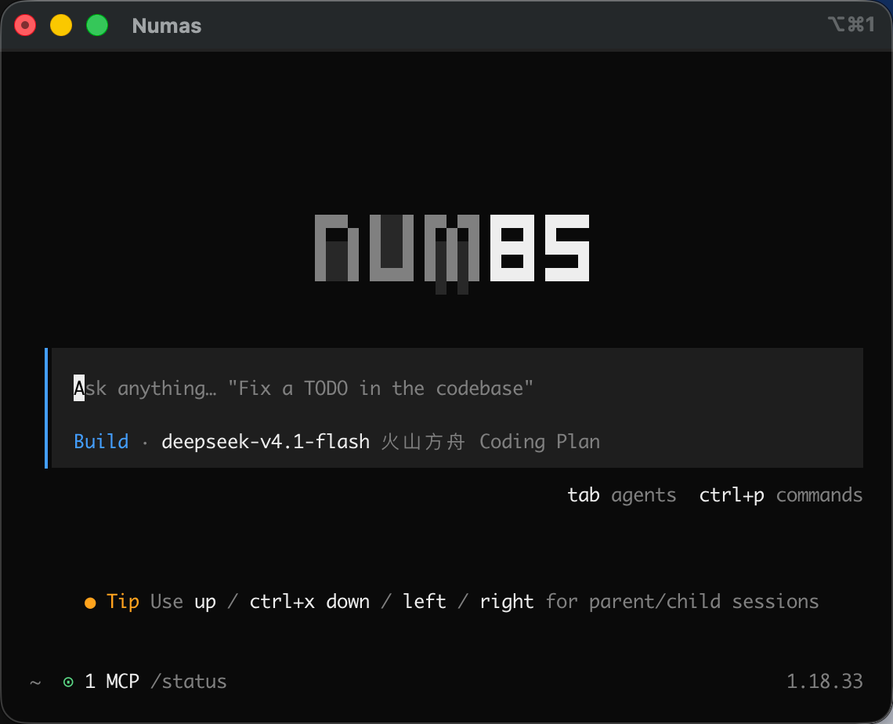
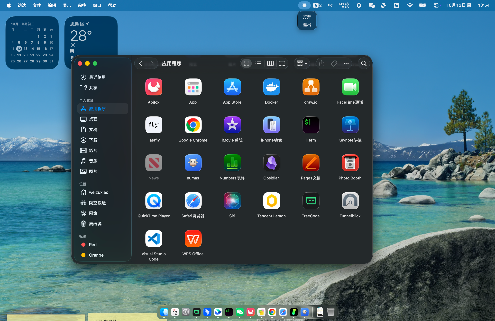
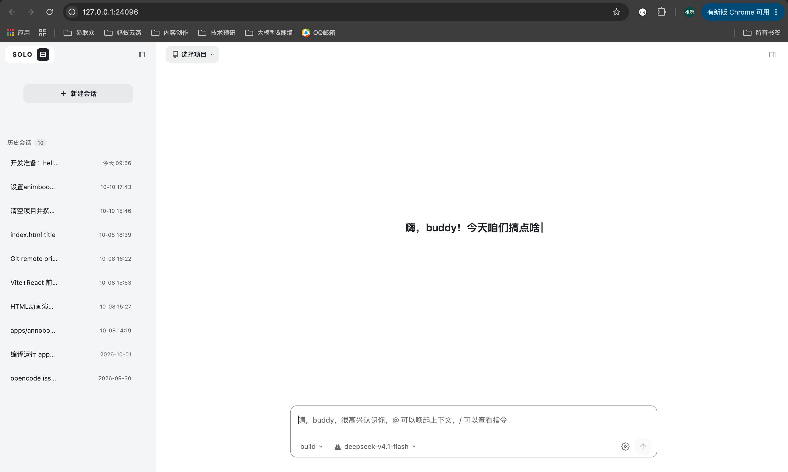
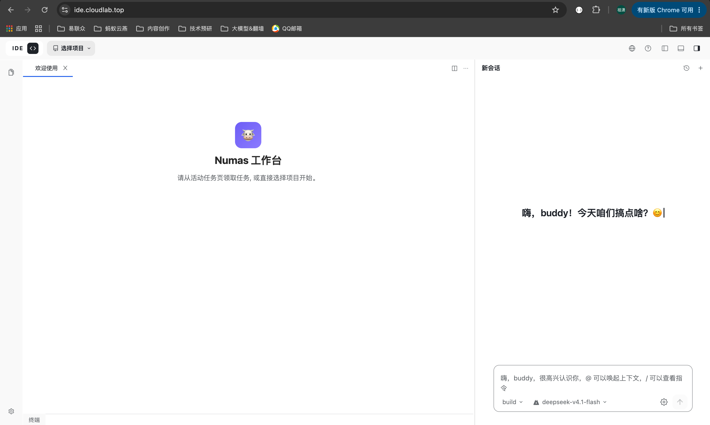

# [Numas](https://github.com/weizuxiao911/numa)

Numas 是一个本地运行的 AI 工作台（编码 / 办公任务），由三部分组成：

- opencode 引擎 — AI Agent 运行时（工具调用 / 会话 / 模型/provider 接入），CLI 命令名 numas
- webapp IDE — 浏览器端工作台（编辑器 / 终端 / 扩展市场）
- 桌面壳 — Windows、macOS 应用（托盘常驻，托管本地服务）

默认本地运行，数据与文件不出本机；也支持前后端分离部署（页面在云端，直连访问者本机的 numas）。

## 1. 支持多种运行模式

### 1.1 CLI 本地运行模式



### 1.2 桌面应用运行模式




### 1.3 云端 + 本地 运行模式




## 2. AI Agent 运行时支持

### 2.1 支持用户级、项目级运行时配置

- 用户级 `~/.opencode/`
- 项目级 `<项目路径>/.opencode/`

```text
.opencode/
├── agents/      # 自定义 Agent（*.md，含 frontmatter）；也支持单数 agent/
├── commands/    # 自定义斜杠命令（*.md）；也支持单数 command/
├── modes/       # 自定义模式（*.md）；也支持单数 mode/
├── plugins/     # 插件（*.ts / *.js）；也支持单数 plugin/
├── skills/      # 技能（<技能名>/SKILL.md）
├── tools/       # 自定义工具（*.ts / *.js）；也支持单数 tool/
├── themes/      # 自定义主题（*.json）
└── opencode.json / opencode.jsonc   # 项目级配置
```

> 官方约定：`.opencode/` 与 `~/.config/opencode/` 下的子目录**优先用复数名**
> （`agents/` `commands/` `modes/` `plugins/` `skills/` `tools/` `themes/`），
> 单数名（`agent/` `command/` …）仅为向后兼容保留。
> 配置读取优先级（后者覆盖前者）：远程 → 全局 → 项目 `opencode.json` →
> `.opencode/` 目录 → `OPENCODE_CONFIG_CONTENT` → 托管配置 → macOS MDM。

### 2.2 内置集成 70 + 服务商的大模型

基于 [AI SDK](https://ai-sdk.dev/) + [Models.dev](https://models.dev) 模型目录，开箱内置集成 70+ 服务商
（目录收录 200+），并支持运行本地模型。

- **国际主流**：OpenAI、Anthropic、Google / Vertex、xAI、Mistral、Cohere、Groq、Cerebras、
  Together / Fireworks / DeepInfra、Amazon Bedrock、Azure、Cloudflare、OpenRouter、Perplexity 等。
- **国内主流**：DeepSeek、Moonshot / Kimi、智谱 / Z.ai、MiniMax、通义 / 阿里云、火山引擎、
  腾讯、小米、阶跃 StepFun、讯飞、SiliconFlow、ModelScope 等。
- **本地模型**：Ollama、LM Studio、vLLM 等本地推理端点。
- **订阅 / 网关类**：GitHub Copilot、GitLab、Vercel、Helicone 等。

添加与使用：

1. 用 `/connect` 添加服务商凭据（API Key 或 OAuth 登录），凭据存于 `~/.local/share/opencode/auth.json`；
2. 在配置中用 `provider` / `model` 指定模型，另可用 `small_model` 指定轻量任务专用模型。

其他能力：

- **自定义模型 / 端点**：支持任意 OpenAI 兼容端点，作为 custom provider 接入；
- **模型能力元数据**：上下文窗口、多模态、推理、工具调用等能力来自 Models.dev 目录，
  界面与 agent 按能力自动适配；
- **精细化控制**：`enabled_providers` / `disabled_providers` 白名单与黑名单，
  `experimental.policies` 可限制可用的 provider。

### 2.3 执行与权限控制

Agent 的每一次执行都可通过 `permission` 配置控制，规则解析为三种动作：

- `"allow"` — 直接执行，无需审批
- `"ask"` — 弹窗提示，由用户批准
- `"deny"` — 直接阻止

**可管控的工具 / 防护项**：

- `bash` — 运行 shell 命令（按解析后的命令匹配，如 `git status --porcelain`）
- `edit` — 所有文件修改（涵盖 edit / write / patch）
- `read` / `glob` / `grep` — 读取、通配、内容搜索
- `task` / `skill` / `lsp` / `webfetch` / `websearch` — 子代理、技能、LSP、抓取、搜索
- `external_directory` — 访问工作目录之外的路径
- `doom_loop` — 同一工具以相同输入重复 3 次时触发（防死循环）

**细粒度规则（对象语法）**：按输入做模式匹配，最后匹配的规则优先。

```jsonc
{
  "permission": {
    "bash": {
      "*": "ask",
      "git *": "allow",
      "rm *": "deny"
    },
    "edit": {
      "*": "deny",
      "packages/web/src/content/docs/*.mdx": "allow"
    }
  }
}
```

**默认行为（宽松 + 安全兜底）**：未配置时多数权限默认 `allow`；
`read` 默认允许但 `.env` 系列默认 `deny`（`.env.example` 除外）；
`doom_loop` 与 `external_directory` 默认 `ask`。

**审批与代理**：`ask` 触发时界面提供 `once`（仅本次）/ `always`（本会话内匹配模式后续放行）/
`reject`（拒绝）三种选择；权限可按 agent 单独覆盖，规则与全局合并后 agent 优先。

- **只读 / 全权两类 Agent**：内置 `plan` 为只读（默认拒绝改文件、执行 bash 前询问），
  `build` 为完整权限；
- **执行环境**：`bash` 在项目环境中执行 shell 命令，支持配置默认 shell（`shell` 选项），
  各 agent 的每次工具调用都受同一套权限规则约束。

### 2.4 内置工具集

Agent 通过一组内置工具操作代码库与环境（默认全部启用，行为受 §2.3 权限控制）：

| 工具 | 作用 |
| --- | --- |
| `read` | 读取文件内容（支持图片 / PDF 附件） |
| `write` | 新建或覆盖文件 |
| `edit` | 精确字符串替换式修改文件 |
| `patch` | 应用 diff / 补丁 |
| `bash` | 在项目环境中执行 shell 命令 |
| `glob` | 按模式查找文件 |
| `grep` | 正则搜索文件内容 |
| `task` | 启动子 Agent 处理独立子任务 |
| `webfetch` | 抓取指定 URL 内容 |
| `websearch` | 联网搜索 |
| `skill` | 按需加载代理技能（SKILL.md） |
| `todowrite` | 维护任务清单 / 进度 |
| `question` | 在执行中向用户提问、请求拍板 |
| `lsp` | LSP 查询（实验性） |

可扩展的工具来源（怎么用 / 怎么扩见 §3）：

- **自定义工具**：`.opencode/tools/*.ts`，导出 `tool({...})` 即成为 agent 可调用工具；
- **MCP 服务器**：接入 Model Context Protocol，暴露工具 / 资源 / prompt；
- **插件**：通过插件钩子注入或改写工具行为；
- **技能**：`SKILL.md` 封装可复用指令，按需通过 `skill` 工具加载。

## 3. 使用与拓展

### 3.1 自定义集成模型

**接入任意 OpenAI 兼容端点**（本地推理 / 自建网关 / 代理）：

```jsonc title="~/.config/opencode/opencode.json 或 .opencode/opencode.jsonc"
{
  "$schema": "https://opencode.ai/config.json",
  "provider": {
    "my-gateway": {
      "npm": "@ai-sdk/openai-compatible",
      "name": "My Gateway",
      "options": {
        "baseURL": "http://127.0.0.1:1337/v1",
        "apiKey": "{env:MY_API_KEY}"
      },
      "models": {
        "my-model-id": { "name": "My Model" }
      }
    }
  }
}
```

- `npm` 指定 SDK 适配包（OpenAI 兼容用 `@ai-sdk/openai-compatible`）；
- `options.baseURL` 指向端点，`models` 列出可用模型（id 需与 `GET /v1/models` 一致）；
- 敏感值用 `{env:VAR}` / `{file:path}` 变量引用，不写死。

**覆盖已内置服务商**：直接在 `provider.<id>.options` 里改 `baseURL` / `apiKey` / 超时等
（`timeout` / `headerTimeout` / `chunkTimeout`）。

**模型选择与限制**：`model` 设默认主模型、`small_model` 设轻量任务模型；
`enabled_providers` / `disabled_providers` 做白 / 黑名单。

### 3.2 自定义集成 skill

技能 = 一段可复用指令，放在 `<技能名>/SKILL.md`：

- **位置**：项目级 `.opencode/skills/<name>/SKILL.md`；全局级 `~/.config/opencode/skills/<name>/SKILL.md`；
  也兼容 Claude（`.claude/skills/`）与 Agents（`.agents/skills/`）目录。
- **发现**：项目本地从当前目录向上遍历到 git worktree 根，逐级加载匹配的 `SKILL.md`。
- **名称规则**：目录名与 frontmatter `name` 必须一致，仅小写字母 / 数字 / 单连字符。

```markdown title=".opencode/skills/code-review/SKILL.md"
---
name: code-review
description: 按团队规范审查改动，聚焦安全、性能与可维护性
---

## What I do
- 逐文件审查变更，标注风险点
## When to use me
- 用户要求审查代码 / PR 时
```

技能通过 `skill` 工具**按需加载**：agent 先看到名称与描述，需要时再拉取全文；
可用权限 (`skill`) 控制哪些技能允许被加载。

### 3.3 自定义集成 MCP

MCP（Model Context Protocol）为 agent 扩展工具 / 资源 / prompt。在配置的 `mcp` 段声明：

**本地（stdio）**：

```jsonc title="opencode.jsonc"
{
  "mcp": {
    "my-local-mcp": {
      "type": "local",
      "command": ["npx", "-y", "my-mcp-command"],
      "enabled": true,
      "environment": { "MY_ENV_VAR": "value" }
    }
  }
}
```

**远程（HTTP）**：

```jsonc title="opencode.jsonc"
{
  "mcp": {
    "my-remote-mcp": {
      "type": "remote",
      "url": "https://my-mcp-server.com",
      "headers": { "Authorization": "Bearer MY_API_KEY" }
    }
  }
}
```

- 本地用 `command` + `environment`；远程用 `url` + `headers`（支持 OAuth 自动认证）；
- 两者都支持 `enabled`（开关）与 `timeout`（拉取工具超时，默认 5s）；
- 接入后其工具按 `mcp:*` 参与权限控制（见 §2.3），提示里可直接点名使用。

### 3.4 自定义拓展开发

三类扩展开发方式：

**1. 自定义工具**（`.opencode/tools/*.ts` 或 `~/.config/opencode/tools/`）：

```ts title=".opencode/tools/database.ts"
import { tool } from "@opencode-ai/plugin"

export default tool({
  description: "Query the project database",
  args: { query: tool.schema.string().describe("SQL query to execute") },
  async execute(args, context) {
    // context: { agent, sessionID, messageID, directory, worktree }
    return `Executed: ${args.query}`
  },
})
```

- **文件名即工具名**；一个文件多导出则命名为 `<文件名>_<导出名>`（如 `math_add`）；
- 参数用 `tool.schema`（Zod）定义；同名会**覆盖**内置工具（谨慎）；
- 定义文件用 TS/JS，但 `execute` 内部可调用任何语言的脚本。

**2. 插件**（`.opencode/plugins/*.ts|js`）：

```ts title=".opencode/plugins/example.ts"
import type { Plugin } from "@opencode-ai/plugin"

export const MyPlugin: Plugin = async ({ project, client, $, directory, worktree }) => {
  return {
    // 钩子实现
  }
}
```

- 入参含 `client`（OpenCode SDK）、`$`（Bun Shell）、`directory` / `worktree`；
- 可订阅事件：`tool.execute.before/after`、`file.edited`、`session.*`、`permission.*`、
  `tui.*` 等；也可注入环境变量、注册自定义工具、做通知 / 日志 / 压缩钩子；
- 可从本地文件或 npm 包加载。

**3. 自定义 Agent**（`.opencode/agents/*.md` 或 JSON `agent` 段）：指定 model / prompt /
可用工具与权限，扩展出专用角色的主 / 子代理。


